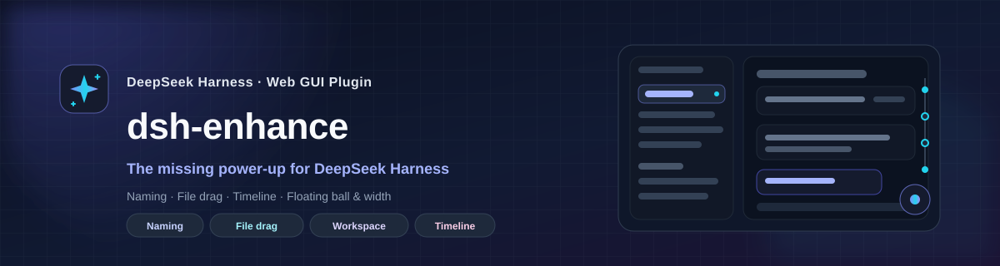
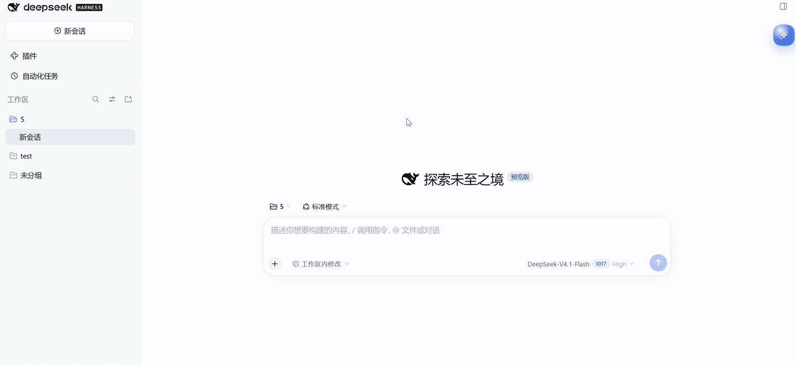
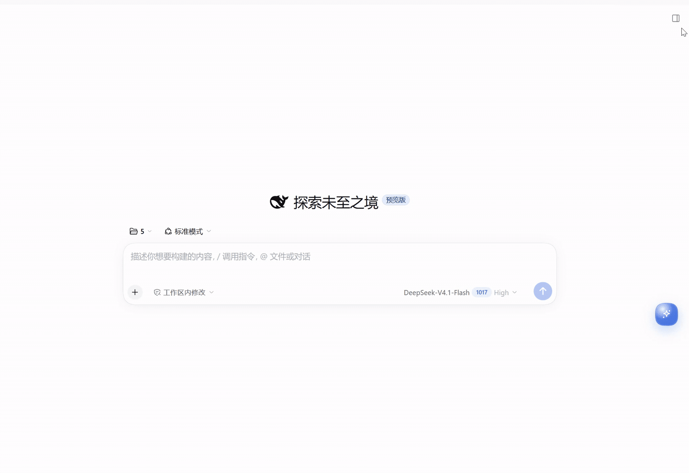
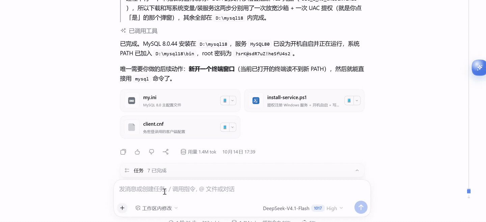
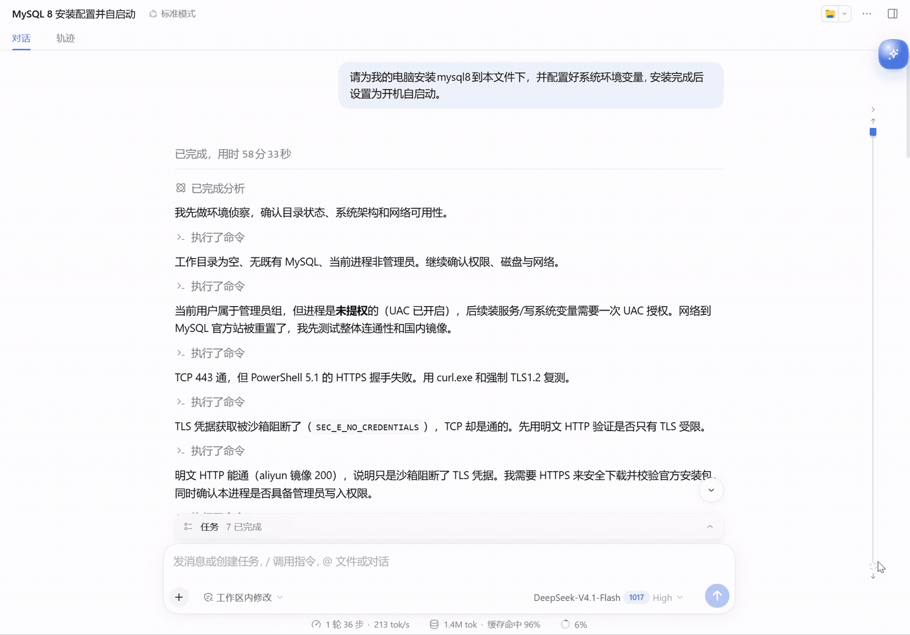
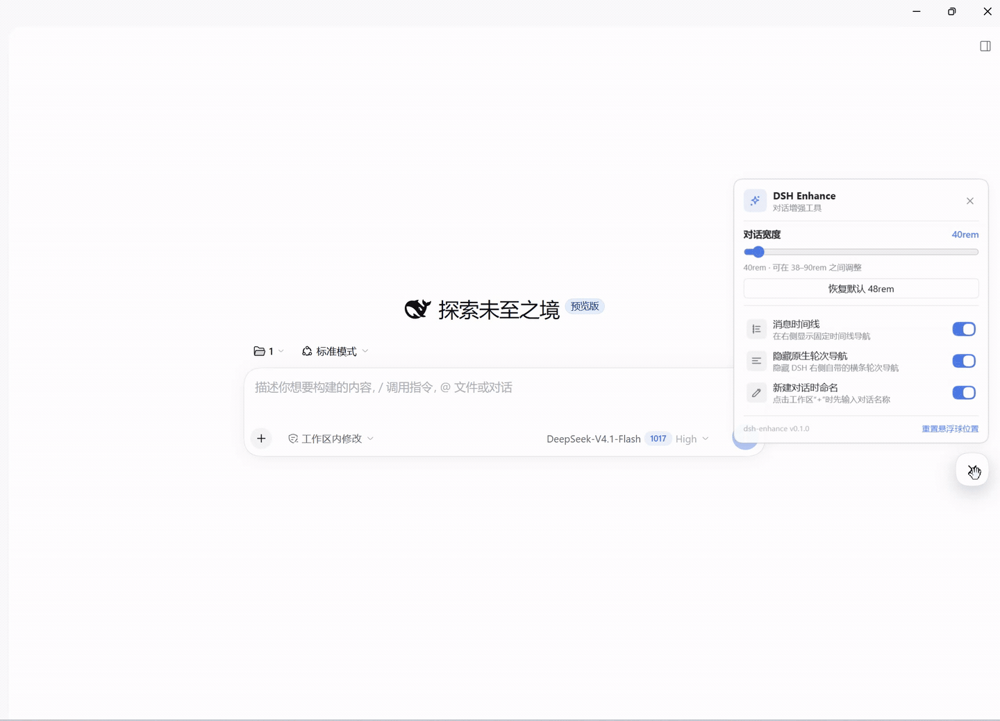

English | [简体中文](README.zh.md)

<div align="center">



<h1>dsh-enhance</h1>

<p><strong>The missing conversation power-up for DeepSeek Harness ✨</strong></p>

<p>New-conversation naming, file drag references, edit-and-resend for the last prompt, a message timeline, and a draggable floating ball with chat-width control for the DSH Web GUI.</p>

<p>
  
  
  
  
  
</p>

<p>
  <a href="#features">✨ Features</a> ·
  <a href="#install">📥 Install</a> ·
  <a href="#quick-start">🚀 Quick Start</a> ·
  <a href="#development">🛠️ Development</a> ·
  <a href="#faq">❓ FAQ</a>
</p>

</div>

---

> I use DeepSeek Harness every day. New sessions need useful names; finding a message in a long thread means scrolling; referencing a file means copying its path; correcting the last prompt should be quick.
>
> So I built **dsh-enhance**: it leaves DSH’s native structure alone and just makes the daily actions smoother.

<a id="features"></a>
## ✨ Features

| | Feature | What you get |
| --- | --- | --- |
| ✏️ | **New conversation naming** | Name it from the workspace `+` before creating it |
| 📎 | **File drag reference** | Drag a file or folder into the composer as an `@path` |
| ✍️ | **Edit & resend** | Stop a turn, edit the sent prompt inline, and send it again |
| 📍 | **Message timeline** | Scan, preview, and jump through long threads |
| 🫧 | **Floating ball & width** | Everyday tools one click away; 38–90rem live width |

> The GIFs below are recordings from DSH. The UI may look different with another theme or window size.

### ✏️ New Conversation Naming

**Name it before you create it.** Clicking `+` on a workspace title row opens a naming dialog instead of creating another “New Session”.

- Type a name and press Enter; **Skip naming** keeps the native one-click flow.
- The name is written as the conversation title; before the first turn, the sidebar blank row shows it.
- Turn **Name new conversations** off in the quick panel to restore the native behavior.



### 📎 File Drag Reference

**Drop a file, get a reference.** Open the **Files** tab in the right sidebar and drag a file or folder row into the composer:

- The composer shows **Drop to reference <name>**; on release it inserts an `@relative/path` chip.
- The file is not moved, copied, or rewritten; the model reads it through its file tools when you send.
- Paths are relative to the conversation workspace root; paths with spaces use `@"..."`.
- Folders are inserted with a trailing `/` (`@path/`) so the model can browse the directory.
- The composer gets an accent outline while dragging; dropping elsewhere inserts nothing.



### ✍️ Edit & Resend the Last Prompt

**Stop, tweak, send again.** When the conversation is idle, a **pencil** appears beside Copy in your last sent prompt’s action row. Clicking it expands the prompt into a full-width inline editor with Cancel / Send:

- Edit the text, then click **Send** (or press Enter; Shift+Enter inserts a line, Esc cancels).
- Sending forks the conversation **before the turn that carried that prompt** — including the queued inbox copy — sends the edited text into the new branch, and opens it.
- The branch keeps the earlier history and title. The original is archived when archiving succeeds; otherwise it remains in the conversation list.
- Attachments are not resent; the editor warns when the original prompt had one.

> DSH's log is append-only and has no public "rewrite this message" call, so the edit is a **fork before the turn + resend**, not an in-place mutation. The new conversation gets a new Session ID.



### 📍 Message Timeline

**Never lose your place in a long thread.** A thin fixed timeline sits on the right:

- One node per question/answer turn; each node is anchored on the user question and covers the assistant reply.
- Hover a node for the question, turn, and a content preview.
- Click a node to jump to the question; the top/bottom buttons jump to the first/last.
- The `>` button collapses the rail; turn it off/on in the quick panel.



<a id="floating-ball-chat-width"></a>
### 🫧 Floating Ball & Chat Width

**Everyday tools, one click away.** Drag the floating ball anywhere; click it to open the quick panel:

| Tool | What it does |
| --- | --- |
| **Chat width** | Live 38–90rem, default **48rem**, one-click reset |
| **Message timeline** | Toggle the right timeline rail |
| **Native turn navigation** | Hide the horizontal turn rail DSH draws on the right (on by default) |
| **Name new conversations** | Toggle the workspace `+` naming dialog |
| **Floating ball position** | Reset to the default corner |

Width syncs both ways with DSH’s native drag handle: dragging the handle updates the panel value; adjusting the panel writes DSH’s width preference (`dsh.conversation.contentWidth`).



<a id="install"></a>
## 📥 Installation

### Requirements

- DeepSeek Harness `0.2.1-rc.2` or a compatible 0.2.x Web composition.
- Official Web / Desktop composition (includes `@deepseek-ai/dsh-client-ui-workspace`).
- File drag reference also needs the right-sidebar **Files** tab (included in the official composition).
- Works with both the desktop app and `dsh web`.

### Install from source

```bash
# Clone this repository (or download and extract its ZIP), then:
cd dsh-enhance
pnpm install
pnpm build
dsh plugin --profile desktop add .
```

For the Web profile, use `dsh plugin --profile web add .` instead. Reload the Web page or fully restart the desktop app after installing.

### Install from npm or a plugin index

After the package is published, install `dsh-enhance` in the profile you use:

```bash
dsh plugin --profile web add dsh-enhance
dsh plugin --profile desktop add dsh-enhance
```

The GitHub repository includes the generated `lib/` files for direct installation. When developing from a fresh checkout, run `pnpm build` before installing the local directory. See [publishing notes](docs/PUBLISHING.md).

---

<a id="quick-start"></a>
## 🚀 Quick Start

| I want to… | How |
| --- | --- |
| Name a new conversation | Workspace title row `+` → type a name → create |
| Reference a file | Drag a file / folder from the **Files** tab into the composer |
| Edit the last prompt | Stop the turn, click the **pencil** beside Copy on the last user bubble |
| Jump to a message | Click a node on the right timeline |
| Adjust width / toggles | Click the floating ball → quick panel |

---

<a id="compatibility"></a>
## 🧭 Compatibility

| Item | Status |
| --- | --- |
| DeepSeek Harness | `0.2.1-rc.2` (compatible with 0.2.x) |
| Web GUI | ✅ |
| Desktop | ✅ |
| Windows | ✅ tested |
| macOS / Linux | Expected to work, not tested |

The plugin uses only public DSH slots, DOM markers, public services, and CSS tokens; it does not read private controller state. If a DSH upgrade changes those slots, markers, or services, the plugin may need an update.

---

<a id="development"></a>
## 🛠️ Development

```bash
pnpm install
pnpm build
pnpm typecheck
pnpm verify
```

- `lib/index.js`: host half, a no-op Cordis plugin that mounts the package on the Loader.
- `lib/client.js`: browser half, bundled with esbuild and loaded by the DSH Module Loader.
- Project layout, public extension points, design tradeoffs, known limits: [docs/DEVELOPMENT.md](docs/DEVELOPMENT.md) (Chinese).
- Marketplace publishing guide: [docs/PUBLISHING.md](docs/PUBLISHING.md) (Chinese).

The five GIFs under `assets/` are compressed from the recordings in `test/`.

Install the local working tree into a profile:

```bash
dsh plugin --profile desktop add .
```

---

<a id="faq"></a>
## ❓ FAQ

<details>
<summary><strong>Does dragging a file move or upload it?</strong></summary>

No. The plugin only writes the existing path as an `@relative/path` reference into the draft. The file stays where it is; the model reads it through its file tools when you send.
</details>

<details>
<summary><strong>Why don’t I see the features after installing?</strong></summary>

Confirm the plugin is installed in the target profile, then reload the page; on desktop, fully quit and restart the app. Also confirm DSH is `0.2.1-rc.2` or a compatible 0.2.x.
</details>

<details>
<summary><strong>Why is the timeline sometimes missing?</strong></summary>

The timeline relies on the Chat view’s `data-chat-flow-*` markers; the Trajectory view does not have them. If a message sits inside a collapsed “process” group, you may need to expand that group after jumping.
</details>

<details>
<summary><strong>Does editing the last prompt create a new conversation?</strong></summary>

Yes. DSH keeps an append-only log, so the plugin forks before the prompt’s turn and sends the edited text in the new branch. The branch keeps the earlier history and title. The old conversation is archived if possible; if archiving fails, it remains in the list. Attachments from the original prompt are not resent.
</details>

<details>
<summary><strong>Where are settings stored?</strong></summary>

Only in the current browser: `dsh-enhance.state.v1` stores width, timeline/naming switches, and the floating ball position; `dsh.conversation.contentWidth` is shared with DSH. Nothing is uploaded to a server.
</details>

<details>
<summary><strong>Does the plugin collect data?</strong></summary>

No. There is no telemetry or external reporting; conversations, file paths, and settings stay local.
</details>

---

<a id="contributing"></a>
## 🤝 Contributing

Issues and pull requests are welcome.

1. Fork this repository
2. Create a branch (`git checkout -b feat/amazing-feature`)
3. Commit your changes (`git commit -m 'feat: add amazing feature'`)
4. Push the branch (`git push origin feat/amazing-feature`)
5. Open a pull request

Run `pnpm build` and `pnpm typecheck` before submitting; include a screenshot or GIF for UI changes.

---

<a id="acknowledgements"></a>
## 🌟 Acknowledgements

- README structure and interaction inspiration from [claude-nexus](https://github.com/Qiuner/claude-nexus), a power-up suite for Claude.
- Thanks to [DeepSeek Harness](https://github.com/deepseek-ai/deepseek-harness) for the plugin system and public extension points.
- Thanks to the DSH community plugin authors for exploring what the platform can do.

---

<a id="license"></a>
## 📄 License

MIT License © 2026 dsh-enhance contributors

See [LICENSE](LICENSE).

---

<div align="center">

<p><strong>Built with care for DSH users ❤️</strong></p>

<p>If this plugin helps you, please give it a ⭐ Star!</p>

</div>
