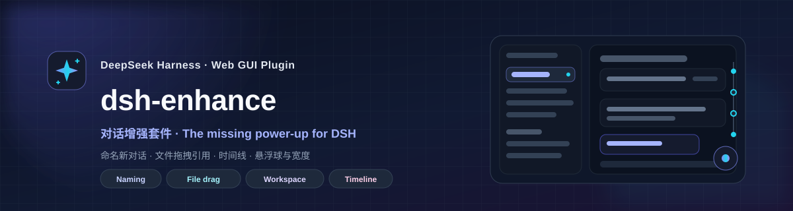

[English](README.md) | 简体中文

<div align="center">



<h1>dsh-enhance</h1>

<p><strong>DeepSeek Harness 对话增强套件 ✨</strong></p>

<p>为 DSH Web GUI 带来新建对话命名、文件拖拽引用、编辑并重发上一条提示词、消息时间线，以及可拖拽的悬浮球与对话宽度控制。</p>

<p>
  
  
  
  
  
</p>

<p>
  <a href="#features">✨ 功能</a> ·
  <a href="#install">📥 安装</a> ·
  <a href="#quick-start">🚀 快速开始</a> ·
  <a href="#development">🛠️ 开发</a> ·
  <a href="#faq">❓ FAQ</a>
</p>

</div>

---

> 我每天都在用 DeepSeek Harness。新会话需要一个好找的名字；长对话里找一条消息要滚很久；引用文件要手动复制路径；上一条提示词写错了也希望能直接修改重发。
>
> 所以我做了 **dsh-enhance**：不改变 DSH 的原生结构，只把每天都会用到的操作做得更顺手。

<a id="features"></a>
## ✨ Features / 功能

| | 功能 | 你能得到什么 |
| --- | --- | --- |
| ✏️ | **新建对话命名** | 工作区 `+` 先命名，再创建对话 |
| 📎 | **文件拖拽引用** | 把文件 / 文件夹拖进输入框，插入 `@路径` |
| ✍️ | **编辑并重发** | 暂停后直接修改已发出的提示词并重新发送 |
| 📍 | **消息时间线** | 长对话里快速定位、预览、跳转 |
| 🫧 | **悬浮球 + 宽度控制** | 常用能力随手打开，38–90rem 实时调宽 |

> 以下 GIF 来自实际操作录屏；界面会随 DSH 主题和窗口大小变化。

### ✏️ 新建对话命名 / New Conversation Naming

**先命名，再开始。** 点击工作区标题行的 `+` 时，先弹出命名对话框，而不是直接生成一个“新会话”。

- 输入名称后按 Enter 创建；也可以点击 **跳过命名** 保持原生一键新建。
- 名称会写入会话标题；首轮消息前，侧边栏空会话行会显示你输入的名称。
- 可在悬浮球面板里关闭 **新建对话时命名**，恢复原生行为。


### 📎 文件拖拽引用 / File Drag Reference

**把文件拖进输入框，只插入引用。** 打开右侧栏的 **文件** 页，把文件或文件夹行拖到对话输入框：

- 输入框提示 **松开以引用 <名称>**，松开后插入 `@相对路径` 引用 chip。
- 文件不会被移动、复制或改写；发送时由模型的文件工具读取。
- 路径相对于当前对话的工作区根目录；带空格的路径自动使用 `@"..."`。
- 文件夹插入以 `/` 结尾的 `@路径/` 引用，便于让模型浏览目录。
- 拖拽期间输入框有业务色描边；拖到其他位置不会插入内容。


### ✍️ 编辑并重发上一条提示词 / Edit & Resend

**暂停后，直接改，再发一次。** 对话空闲时，最后一条已发送提示词的操作行（复制按钮旁）会出现 **铅笔图标**；点击后，这条提示词会展开为全宽内联编辑器，右下角是 **取消 / 发送**：

- 修改文本后点 **发送**（或按 Enter；Shift+Enter 换行，Esc 取消）。
- 发送时会从 **包含这条提示词的那一轮之前** 新建分支（连排队中的 inbox 副本一起排除），把修改后的文本发到新分支并打开它。
- 新分支保留此前历史和标题。若归档成功，原对话可在归档视图恢复；归档失败时，原对话仍留在列表里。
- 原消息里的附件不会重发；存在附件时编辑器会提示。

> DSH 的日志是追加式的，没有公开的“原地改写消息”接口，所以这里采用 **轮次前 fork + 重新发送**，不是原地修改。新对话会使用新的 Session ID。


### 📍 消息时间线 / Message Timeline

**再也不会在长对话里迷路。** 对话右侧固定一条细窄时间线：

- 每个节点对应一轮问答（用户提问 + 助手回答），节点锚定在用户提问处。
- 悬停显示提问、轮次和内容预览。
- 点击节点平滑跳转到用户提问；顶部 / 底部按钮跳到首条 / 最后一条。
- `>` 按钮收起时间线；可在悬浮球面板里整体关闭或开启。


<a id="floating-ball-chat-width"></a>
### 🫧 悬浮球 + 📐 对话宽度调整 / Floating Ball & Chat Width

**常用能力，随手就开。** 右下角悬浮球可拖到任意位置，点击打开快速面板：

| 能力 | 说明 |
| --- | --- |
| **对话宽度** | 38–90rem 实时调整，默认 **48rem**，可一键恢复 |
| **消息时间线** | 开关右侧时间线 |
| **原生轮次导航** | 隐藏 DSH 右侧自带的横条轮次导航（默认开启隐藏） |
| **新建对话时命名** | 开关工作区 `+` 的命名对话框 |
| **悬浮球位置** | 重置回默认位置 |

宽度与 DSH 自带的拖拽手柄双向同步：拖动手柄时面板数值会跟随；用面板调整时也会写入 DSH 的宽度偏好（`dsh.conversation.contentWidth`）。


<a id="install"></a>
## 📥 Installation / 安装

### 环境要求

- DeepSeek Harness `0.2.1-rc.2` 或兼容的 0.2.x Web 组合。
- 官方 Web / Desktop 组合（包含 `@deepseek-ai/dsh-client-ui-workspace`）。
- 文件拖拽引用还需要右侧栏的 **文件** 页（官方默认组合包含）。
- 桌面端与 `dsh web` 均可使用。

### 从源码安装

```bash
# 克隆本仓库（或下载 ZIP 并解压），然后：
cd dsh-enhance
pnpm install
pnpm build
dsh plugin --profile desktop add .
```

安装到 Web profile 时，改用 `dsh plugin --profile web add .`。安装后刷新 Web 页面；桌面端需完全退出并重启。

### 从 npm 或插件索引安装

包发布后，可在所用 profile 中按包名安装：

```bash
dsh plugin --profile web add dsh-enhance
dsh plugin --profile desktop add dsh-enhance
```

GitHub 仓库会包含 `lib/` 构建产物，可直接从仓库安装。全新克隆后若要从本地目录安装，请先运行 `pnpm build`。详见[发布说明](docs/PUBLISHING.md)。

---

<a id="quick-start"></a>
## 🚀 Quick Start / 快速开始

| 想做什么 | 怎么做 |
| --- | --- |
| 给新对话起名 | 工作区标题行 `+` → 输入名称 → 创建 |
| 引用文件 | 右侧“文件”树拖文件 / 文件夹到输入框 |
| 编辑上一条提示词 | 暂停后点最后一条用户气泡旁（复制按钮右侧）的 **铅笔图标** |
| 跳到某条消息 | 点右侧时间线节点 |
| 调宽度 / 开关 | 右下角悬浮球 → 面板 |

---

<a id="compatibility"></a>
## 🧭 Compatibility / 兼容性

| 项目 | 状态 |
| --- | --- |
| DeepSeek Harness | `0.2.1-rc.2`（兼容 0.2.x） |
| Web GUI | ✅ |
| Desktop | ✅ |
| Windows | ✅ 已测试 |
| macOS / Linux | 预期可用，未实测 |

插件只使用 DSH 公开的 Slot、DOM 标记、公开服务和 CSS token，不读取私有控制器状态。DSH 升级后如果 Slot、DOM 标记或公开服务变化，插件可能需要同步适配。

---

<a id="development"></a>
## 🛠️ Development / 开发

```bash
pnpm install
pnpm build
pnpm typecheck
pnpm verify
```

- `lib/index.js`：Host 半侧，空 `apply()`，只负责让 Loader 发现本包。
- `lib/client.js`：浏览器半侧，esbuild 打包后由 DSH Module Loader 加载。
- 详细目录、公开扩展点、设计取舍和已知限制：[docs/DEVELOPMENT.md](docs/DEVELOPMENT.md)。
- 插件市场发布说明：[docs/PUBLISHING.md](docs/PUBLISHING.md)。

`assets/` 中的五张 GIF 由 `test/` 的实际操作录屏压缩生成。

开发时可以直接把本目录安装到 profile：

```bash
dsh plugin --profile desktop add .
```

---

<a id="faq"></a>
## ❓ FAQ / 常见问题

<details>
<summary><strong>拖文件会让文件移动或上传吗？</strong></summary>

不会。插件只把现有路径作为 `@相对路径` 引用写进草稿；文件仍留在原位置，发送时由模型的文件工具读取。
</details>

<details>
<summary><strong>安装后为什么看不到功能？</strong></summary>

先确认插件在目标 profile 中安装成功，然后刷新页面；桌面端需要完全退出并重启应用。另外确认 DSH 版本是 `0.2.1-rc.2` 或兼容的 0.2.x。
</details>

<details>
<summary><strong>时间线为什么有时不显示？</strong></summary>

时间线依赖 Chat 视图的 `data-chat-flow-*` 标记；Trajectory 视图没有这些标记。消息位于折叠的“过程”分组内时，跳转后可能还需要展开该分组。
</details>

<details>
<summary><strong>编辑上一条提示词会新建对话吗？</strong></summary>

会。DSH 的日志是追加式的，插件会在该提示词所在轮次之前 fork 一个新分支，并把修改后的文本发到新分支。新分支保留此前历史和标题；原对话归档成功后可在归档视图恢复，归档失败时仍留在列表里。原提示词中的附件不会重发。
</details>

<details>
<summary><strong>设置存在哪里？</strong></summary>

设置只存在当前浏览器：`dsh-enhance.state.v1` 保存宽度、时间线 / 新建命名开关和悬浮球位置；`dsh.conversation.contentWidth` 与 DSH 共用。不会上传到服务器。
</details>

<details>
<summary><strong>插件会收集数据吗？</strong></summary>

不会。插件没有遥测或外部上报；会话、文件路径和设置都留在本地。
</details>

---

<a id="contributing"></a>
## 🤝 Contributing / 贡献

欢迎提交 [Issue](../../issues) 和 Pull Request。

1. Fork 本仓库
2. 创建功能分支（`git checkout -b feat/amazing-feature`）
3. 提交更改（`git commit -m 'feat: add amazing feature'`）
4. 推送分支（`git push origin feat/amazing-feature`）
5. 发起 Pull Request

提交前请运行 `pnpm build` 和 `pnpm typecheck`；涉及 UI 的改动请附截图或 GIF。

---

<a id="acknowledgements"></a>
## 🌟 Acknowledgements / 致谢

- README 结构与交互灵感来自 [claude-nexus](https://github.com/Qiuner/claude-nexus) —— 一个为 Claude 打造的增强套件。
- 感谢 [DeepSeek Harness](https://github.com/deepseek-ai/deepseek-harness) 提供的插件系统与公开扩展点。
- 感谢所有 DSH 社区插件作者的探索。

---

<a id="license"></a>
## 📄 License / 许可证

MIT License © 2026 dsh-enhance contributors

详见 [LICENSE](LICENSE)。

---

<div align="center">

<p><strong>为 DSH 用户用心打造 ❤️</strong></p>

<p>如果这个插件帮到了你，欢迎点一个 ⭐ Star！</p>

</div>
